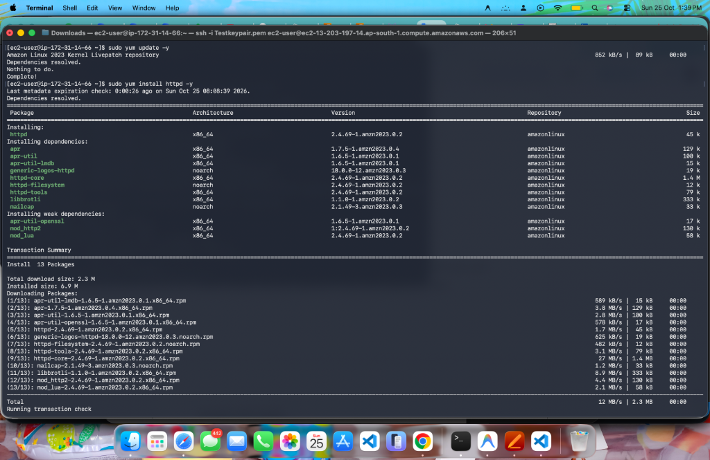
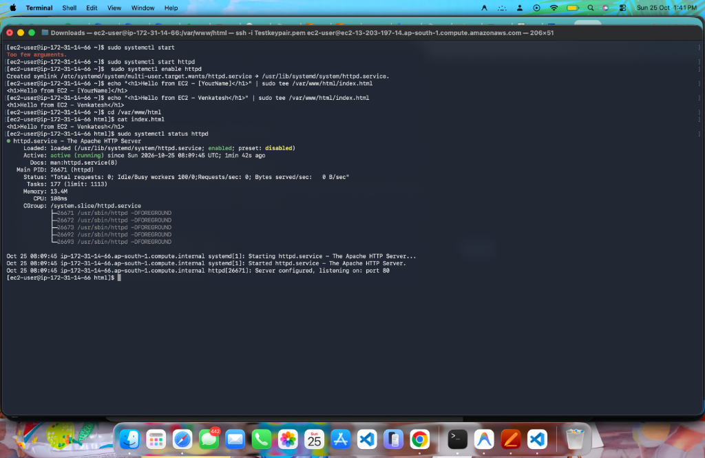
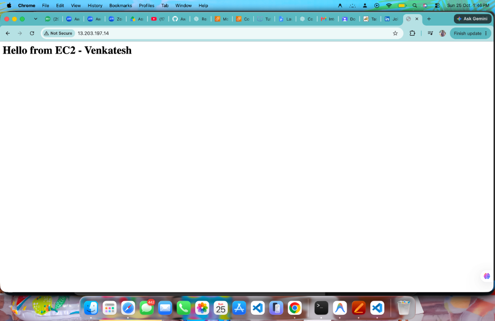
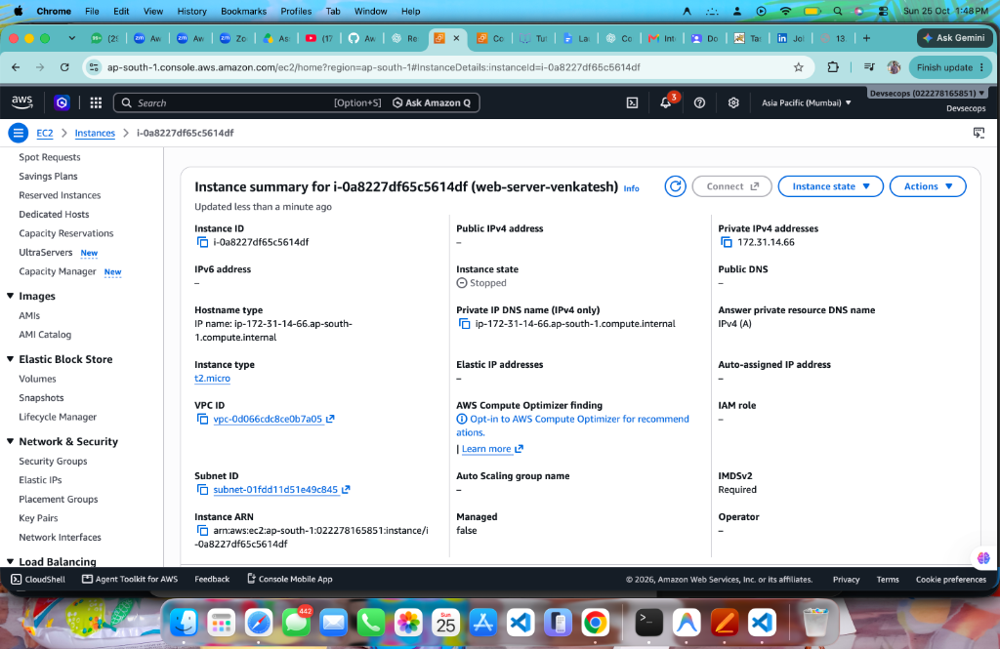
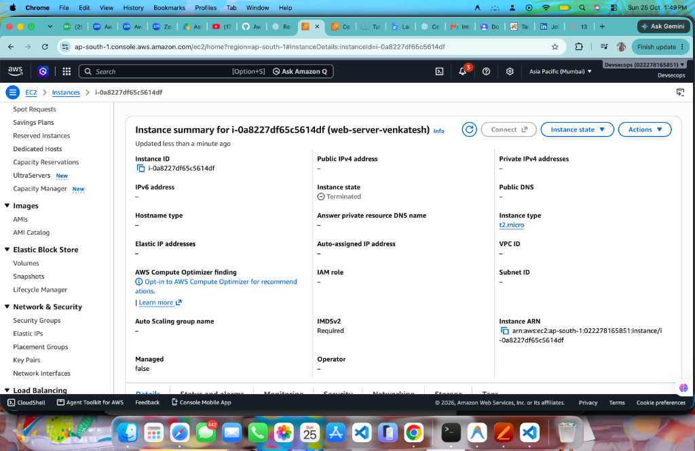

# Task 3 – Launch a Free-Tier EC2 Instance, Connect via SSH, Install Apache, and Serve a Custom Webpage

---
## 📸 Step-by-Step Implementation with Screenshots & Verification

### Step 1: Connect via SSH, Update Repositories & Install Apache HTTP Server

* **Action:**
  1. Set permissions on private key: `chmod 400 Testkeypair.pem`.
  2. Connect to the EC2 public DNS endpoint: `ssh -i Testkeypair.pem ec2-user@ec2-13-203-197-14.ap-south-1.compute.amazonaws.com`.
  3. Execute `sudo yum update -y` to refresh package repositories.
  4. Execute `sudo yum install httpd -y` to install Apache web server.
* **Output / Confirmation:**
  * Package manager successfully resolved dependencies: 13 packages installed (total download size 2.3 MB, installed size 6.9 MB).
  * Transaction check and installation completed successfully.

#### Screenshot 1: SSH Connection, Repository Update & Apache Installation

---

### Step 2: Start & Enable Apache, Deploy Custom HTML Page, and Verify Service Status

* **Action:**
  1. Start the HTTP server: `sudo systemctl start httpd`.
  2. Enable the service across reboots: `sudo systemctl enable httpd`.
  3. Create custom index page: `echo "<h1>Hello from EC2 - Venkatesh</h1>" | sudo tee /var/www/html/index.html`.
  4. Verify file content: `cd /var/www/html && cat index.html`.
  5. Check service health: `sudo systemctl status httpd`.
* **Output / Confirmation:**
  * Systemd symlink created: `/etc/systemd/system/multi-user.target.wants/httpd.service → /usr/lib/systemd/system/httpd.service`.
  * Index file content confirmed: `<h1>Hello from EC2 - Venkatesh</h1>`.
  * Service status confirms: `Active: active (running)`, Main PID: 26671 (`httpd`), `Server configured, listening on: port 80`.

#### Screenshot 2: Apache Service Active & Custom HTML Page Deployed

---

### Step 3: Browse to Custom Webpage via Public IP

* **Action:**
  1. Copy the instance's public IPv4 address (`13.203.197.14`).
  2. Open Google Chrome and navigate to `http://13.203.197.14`.
* **Output / Confirmation:**
  * Web browser connects over HTTP port 80 allowed by the security group.
  * Browser displays custom webpage: **`Hello from EC2 - Venkatesh`**.

#### Screenshot 3: Custom Webpage Loading in Web Browser

---

### Step 4: Stop Instance & Verify Public IP Release

* **Action:**
  1. Return to the AWS EC2 Management Console in region `ap-south-1`.
  2. Select instance `web-server-venkatesh` (`i-0a8227df65c5614df`).
  3. Choose **Instance state → Stop instance**.
  4. Wait for instance state transition to complete.
* **Output / Confirmation:**
  * **Instance state:** `Stopped`.
  * **Public IPv4 address:** `-` (Empty / Released back to the AWS public pool).
  * **Private IPv4:** `172.31.14.66` remains allocated.
  * Demonstrates that dynamic public IPv4 addresses on standard EC2 instances are released upon stopping. (Upon restart, a new dynamic public IPv4 address is assigned unless an Elastic IP is attached).

#### Screenshot 4: Instance Stopped with Public IP Released

---

### Step 5: Terminate EC2 Instance for Clean Up

* **Action:**
  1. Select instance `web-server-venkatesh` (`i-0a8227df65c5614df`).
  2. Choose **Instance state → Terminate instance**.
  3. Confirm termination.
* **Output / Confirmation:**
  * **Instance state:** `Terminated`.
  * All compute resources stopped, EBS root volume deleted, and all billable hourly usage halted.

#### Screenshot 5: EC2 Instance Successfully Terminated

---

## 🔒 Security Group Configuration Details

* **Inbound Rules Configured:**
  * **SSH (Port 22):** Protocol `TCP`, Port Range `22`, Source `My IP /32`.
    * *Purpose:* Restricts remote shell administrative access strictly to the administrator's authorized IP address, preventing brute-force attacks.
  * **HTTP (Port 80):** Protocol `TCP`, Port Range `80`, Source `0.0.0.0/0` (Anywhere IPv4).
    * *Purpose:* Allows public web traffic from any client browser across the internet to access the Apache web server.
* **Outbound Rules:**
  * All traffic allowed (`0.0.0.0/0`) by default, enabling package downloads and repository updates.

---

