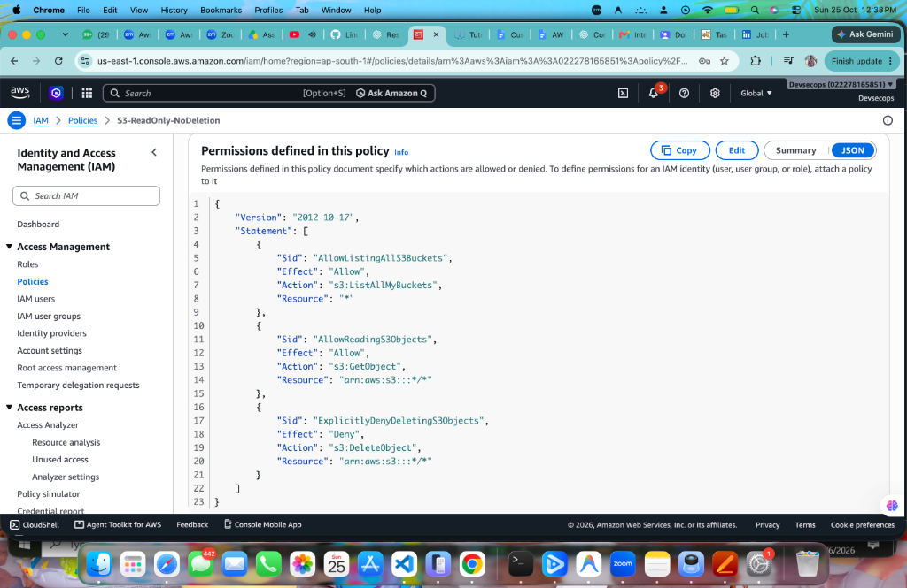
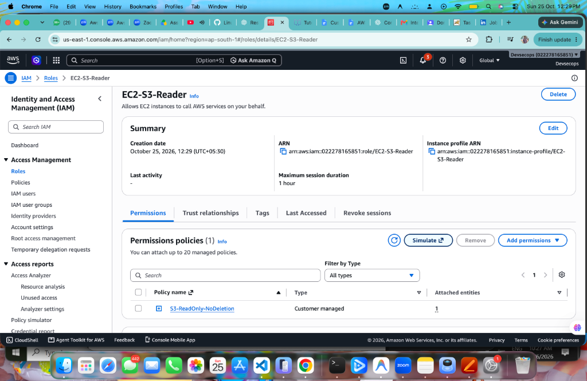
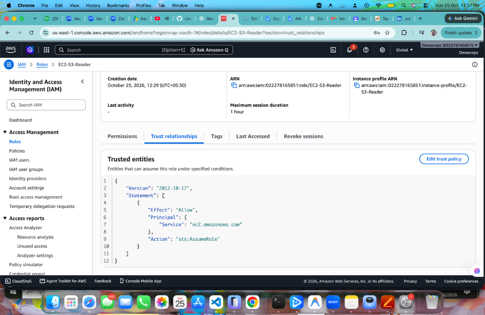
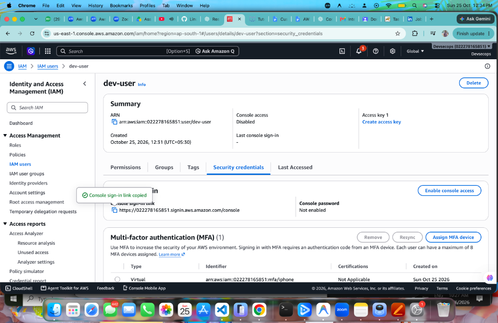
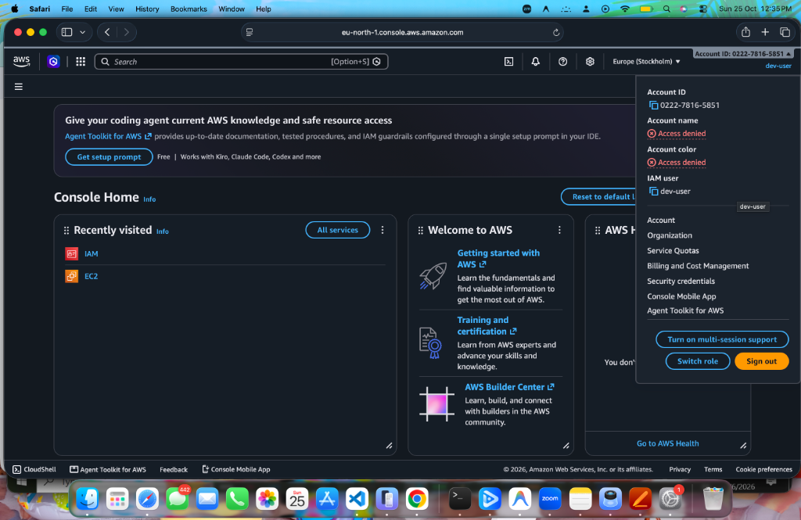

# Task 2 – Custom IAM Policy, EC2 Role & MFA Configuration

---

## 📋 Document Header

* **Full Name:** Venkatesh
* **Assignment Number & Name:** Task 2 – Custom IAM Policy, EC2 Role & MFA
* **Submission Date:** October 25, 2026
* **AWS Region Used:** Global (`us-east-1` for IAM Console; activity validated in `ap-south-1` / `eu-north-1`)
* **AWS Account ID:** `022278165851` (Devsecops)

---

## 📌 Assignment Task Statement

### Objective
Write a custom IAM policy, create an EC2 role using the policy, and enable MFA on an IAM user.

### What You Need To Do
1. Go to **IAM → Policies → Create Policy → JSON editor**.
2. Write a custom policy that:
   * Allows `s3:ListAllMyBuckets`
   * Allows `s3:GetObject`
   * Explicitly denies `s3:DeleteObject`
3. Name the policy: `S3-ReadOnly-NoDeletion`
4. Go to **IAM → Roles → Create Role**.
5. Trusted entity: **AWS Service → EC2**
6. Attach policy: `S3-ReadOnly-NoDeletion`
7. Name the role: `EC2-S3-Reader`
8. Create role.
9. Go to **IAM → Users → dev-user → Security Credentials**.
10. Assign MFA device.
11. Select **Virtual MFA device**.
12. Scan QR code with Google Authenticator.
13. Complete setup.
14. Log out.
15. Log in as `dev-user`.
16. Confirm MFA prompt appears before console access.
17. Log back in as root/admin.
18. Go to **IAM → Roles → EC2-S3-Reader → Trust Relationships tab**.
19. Review the trust policy JSON. Note: `ec2.amazonaws.com` as the trusted service.
20. Go to **IAM → Policies → S3-ReadOnly-NoDeletion → Policy summary**.
21. Verify: Allowed actions and Explicitly denied action.

> **Free Tier Notice:** IAM roles, policies, and MFA are completely free services provided by AWS.

---

## 📜 Full JSON Policy Documents

### 1. Custom Policy JSON (`S3-ReadOnly-NoDeletion`)
```json
{
    "Version": "2012-10-17",
    "Statement": [
        {
            "Sid": "AllowListingAllS3Buckets",
            "Effect": "Allow",
            "Action": "s3:ListAllMyBuckets",
            "Resource": "*"
        },
        {
            "Sid": "AllowReadingS3Objects",
            "Effect": "Allow",
            "Action": "s3:GetObject",
            "Resource": "arn:aws:s3:::*/*"
        },
        {
            "Sid": "ExplicitlyDenyDeletingS3Objects",
            "Effect": "Deny",
            "Action": "s3:DeleteObject",
            "Resource": "arn:aws:s3:::*/*"
        }
    ]
}
```

### 2. Role Trust Policy JSON (`EC2-S3-Reader`)
```json
{
    "Version": "2012-10-17",
    "Statement": [
        {
            "Effect": "Allow",
            "Principal": {
                "Service": "ec2.amazonaws.com"
            },
            "Action": "sts:AssumeRole"
        }
    ]
}
```

---

## 🛠️ Step-by-Step Implementation with Explanations & Verification

### Step 1: Create Custom IAM Policy (`S3-ReadOnly-NoDeletion`)

1. **Navigate to Policies:** Open the AWS Management Console and go to **IAM** → **Policies** in the left navigation sidebar.
   * *Explanation:* Accesses the IAM policy management interface to create custom authorization definitions.
2. **Open JSON Editor:** Click **Create policy** and select the **JSON** tab in the policy editor.
   * *Explanation:* Allows directly authoring policy statements with specific `Effect`, `Action`, and `Resource` elements.
3. **Specify Policy Statements:** 
   * Add statement with `Sid`: `AllowListingAllS3Buckets`, `Effect`: `Allow`, `Action`: `s3:ListAllMyBuckets`, `Resource`: `*`.
   * Add statement with `Sid`: `AllowReadingS3Objects`, `Effect`: `Allow`, `Action`: `s3:GetObject`, `Resource`: `arn:aws:s3:::*/*`.
   * Add statement with `Sid`: `ExplicitlyDenyDeletingS3Objects`, `Effect`: `Deny`, `Action`: `s3:DeleteObject`, `Resource`: `arn:aws:s3:::*/*`.
   * *Explanation:* Grants permissions to view buckets and read object content while establishing a strict explicit deny on object deletion that overrides any conflicting allow rules.
4. **Name and Review:** Click **Next**, enter Policy name as `S3-ReadOnly-NoDeletion`, and click **Create policy**.
   * *Explanation:* Saves and registers the customer-managed policy under the AWS account.

#### Confirmation & Output:
* **Status:** Policy `S3-ReadOnly-NoDeletion` successfully created.
* **ARN:** `arn:aws:iam::022278165851:policy/S3-ReadOnly-NoDeletion`

#### Screenshot 1: Custom Policy JSON (`S3-ReadOnly-NoDeletion`)


---

### Step 2: Create IAM Role for EC2 and Attach Custom Policy

1. **Navigate to Roles:** In the IAM navigation menu, click **Roles** and then click **Create role**.
   * *Explanation:* Initiates the workflow for defining an IAM identity that AWS services can assume.
2. **Select Trusted Entity:** Choose **AWS service** as the trusted entity type and select **EC2** as the common use case.
   * *Explanation:* Configures the trust relationship allowing the EC2 service (`ec2.amazonaws.com`) to assume the role via AWS STS (`sts:AssumeRole`).
3. **Attach Permissions:** In the Add permissions screen, filter for and check `S3-ReadOnly-NoDeletion`.
   * *Explanation:* Associates the read-only and no-deletion permissions with the EC2 role.
4. **Name and Create Role:** Enter the role name as `EC2-S3-Reader`, review summary details, and click **Create role**.
   * *Explanation:* Creates the IAM role and provisions its corresponding instance profile for EC2 attachments.

#### Confirmation & Output:
* **Status:** Role `EC2-S3-Reader` successfully created with `S3-ReadOnly-NoDeletion` attached.
* **Role ARN:** `arn:aws:iam::022278165851:role/EC2-S3-Reader`
* **Instance Profile ARN:** `arn:aws:iam::022278165851:instance-profile/EC2-S3-Reader`

#### Screenshot 2: IAM Role Permissions Summary


---

### Step 3: Verify Trust Relationship Policy

1. **Open Role Details:** Navigate to **IAM** → **Roles** → click on `EC2-S3-Reader`.
   * *Explanation:* Opens the detailed configuration pane for the newly created EC2 role.
2. **Inspect Trust Relationships:** Select the **Trust relationships** tab.
   * *Explanation:* Displays the trust policy governing which principals are permitted to assume the role.
3. **Verify Service Principal:** Confirm that the trusted entity is `ec2.amazonaws.com` and the action permitted is `sts:AssumeRole`.
   * *Explanation:* Validates that only Amazon EC2 compute instances can assume this role to obtain temporary security credentials.

#### Confirmation & Output:
* **Trusted Principal:** `ec2.amazonaws.com`
* **Allowed Action:** `sts:AssumeRole`

#### Screenshot 3: Role Trust Policy JSON


---

### Step 4: Configure Virtual MFA on IAM User (`dev-user`)

1. **Navigate to Users:** In IAM navigation sidebar, click **Users** and select `dev-user`.
   * *Explanation:* Opens user profile to configure security and authentication credentials.
2. **Open Security Credentials:** Switch to the **Security credentials** tab.
   * *Explanation:* Provides access to password settings, access keys, and Multi-factor authentication (MFA) devices.
3. **Assign MFA Device:** In the Multi-factor authentication (MFA) section, click **Assign MFA device**.
   * *Explanation:* Begins the device enrollment process for two-factor security.
4. **Enroll Virtual MFA:** Enter device name (e.g., `iphone`), select **Authenticator app** (Virtual MFA device), display QR code, and scan using Google Authenticator / Apple Authenticator.
   * *Explanation:* Pairs the physical mobile authenticator app with AWS IAM using Time-based One-Time Password (TOTP) algorithm.
5. **Submit MFA Codes:** Enter two consecutive 6-digit TOTP codes from the authenticator app and click **Add MFA**.
   * *Explanation:* Synchronizes and validates the time step between the authenticator app and AWS IAM authentication servers.

#### Confirmation & Output:
* **Status:** Virtual MFA device successfully assigned and active.
* **MFA Identifier:** `arn:aws:iam::022278165851:mfa/iphone`
* **User ARN:** `arn:aws:iam::022278165851:user/dev-user`

#### Screenshot 4: Active MFA Device Confirmation


---

### Step 5: Test and Confirm MFA Prompt & Login as `dev-user`

1. **Sign Out Admin / Root:** Sign out of the AWS management console.
   * *Explanation:* Clears existing administrator session cookies.
2. **Open IAM Sign-in URL:** Navigate to `https://022278165851.signin.aws.amazon.com/console`.
   * *Explanation:* Directs to the dedicated account sign-in endpoint for IAM identities.
3. **Provide Credentials:** Enter Account ID `022278165851`, Username `dev-user`, and password.
   * *Explanation:* Authenticates first factor (username and password).
4. **Complete MFA Challenge:** When prompted for the MFA code, enter the current 6-digit dynamic code from Google Authenticator and click **Submit**.
   * *Explanation:* Validates second factor authentication before granting session tokens.
5. **Verify Authenticated Session:** Observe the AWS Management Console home page with `dev-user` identity displayed in the top right user navigation bar.
   * *Explanation:* Verifies that access is granted securely only after successful multi-factor authentication.

#### Confirmation & Output:
* **Logged-in IAM Identity:** `dev-user`
* **AWS Account:** `0222-7816-5851`
* **Session State:** Successfully authenticated and active.

#### Screenshot 5: dev-user Authenticated Console Session


---
